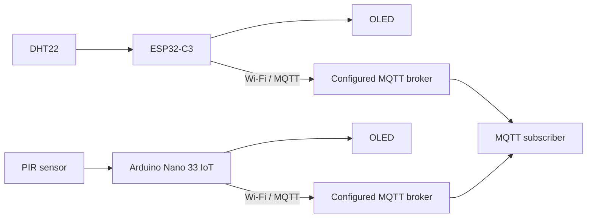

# IoT-Based Distributed Smart Classroom Monitoring System

A two-node embedded IoT prototype that monitors classroom environmental conditions and motion, displays readings locally and publishes telemetry using MQTT over Wi-Fi.

## Architecture

The original sketches used different brokers: a public Mosquitto test broker for the environmental node and a local shiftr.io broker for the motion node. The sanitized revision permits configuring either node for a private broker. A shared broker is optional, not an original verified deployment.

## Hardware and firmware
| Node | Inputs | Local output | Nominal publishing interval |
|---|---|---|---|
| ESP32-C3 | DHT22 temperature and humidity | SSD1306 OLED | 2 s |
| Nano 33 IoT | PIR digital motion signal | SSD1306 OLED | 3 s |

Both nodes report Wi-Fi RSSI. PIR detects motion, not reliable headcount or continuous occupancy.

## Setup
1. Install Arduino IDE and the board packages and libraries listed in [requirements](docs/requirements.md).
2. Follow [wiring](docs/wiring.md), checking your actual module voltage and pinout.
3. In each sketch directory, copy `secrets.example.h` to `secrets.h`. Enter local Wi-Fi and broker settings; never commit this file.
4. Select the correct board and serial port; compile and upload each sketch separately.
5. Open Serial Monitor at 115200 baud and subscribe to the configured MQTT topics as described in [MQTT configuration](docs/mqtt_configuration.md).
6. Follow the [validation plan](docs/validation.md).

## Repository contents
- [Environmental firmware](firmware/esp32_environment/esp32_environment.ino)
- [Motion firmware](firmware/nano_motion/nano_motion.ino)
- [Firmware scope and limitations](docs/firmware_notes.md)
- [Illustrative telemetry](data/example_payloads.jsonl) (synthetic, not recorded hardware data)

Retain the original project report and demonstration video after reviewing them for personal information and sharing permissions. The original MQTT log contains identifying topic strings and should not be republished without sanitization.

## Validation and limitations
The original repository includes an MQTT consumer log with message counters, uptime-like values and RSSI. This supports historical telemetry activity but does not by itself establish sensor accuracy, delivery rates or successful operation of the revised sketches. The revised firmware is a privacy-oriented adaptation of the original code and has not been compiled or hardware-tested in this environment. It uses plain MQTT for a trusted lab network; use authenticated TLS for deployment. No FreeRTOS task creation is present in the inspected sketches.

## Contributions
Academic team project. Add an accurate description of your individual contributions and acknowledge teammates before publishing.
