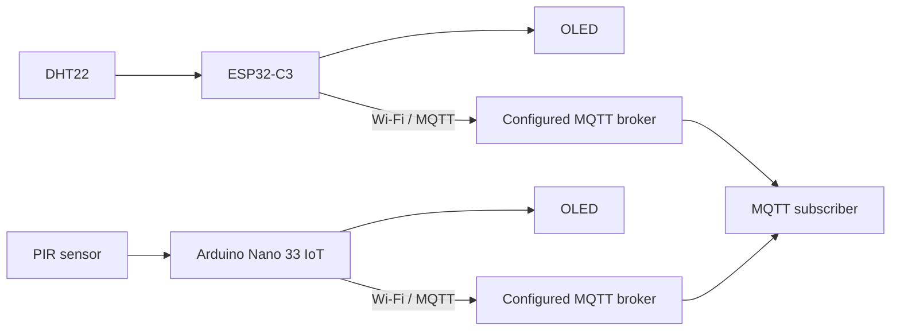
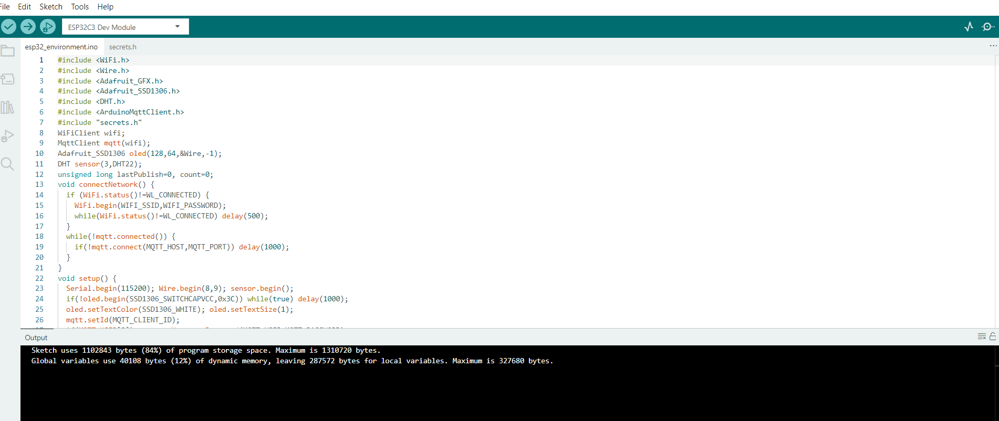
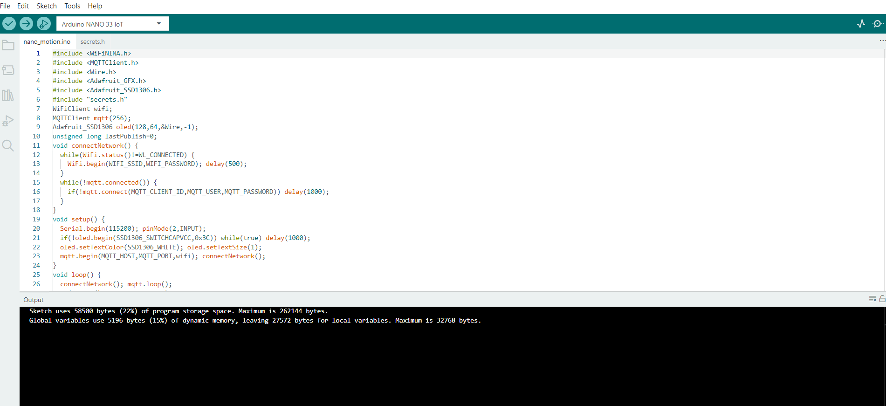

# IoT-Based Distributed Smart Classroom Monitoring System

A two-node embedded IoT prototype that monitors classroom environmental conditions and motion, displays readings locally and publishes telemetry using MQTT over Wi-Fi.

## Architecture

The original sketches used different brokers: a public Mosquitto test broker for the environmental node and a local shiftr.io broker for the motion node. The sanitized revision permits configuring either node for a private broker. A shared broker is optional, not an original verified deployment.

## Hardware and firmware
| Node | Inputs | Local output | Nominal publishing interval |
|---|---|---|---|
| ESP32-C3 | DHT22 temperature and humidity | SSD1306 OLED | 2 s |
| Nano 33 IoT | PIR digital motion signal | SSD1306 OLED | 3 s |

Both nodes report Wi-Fi RSSI. PIR detects motion, not reliable headcount or continuous occupancy.

3. Configure the credentials:
   - ESP32-C3: Copy `secrets_esp32.example.h` to `secrets.h`.
   - Arduino Nano 33 IoT: Copy `secrets.example.h` to `secrets.h`.
   - Enter local Wi-Fi and MQTT broker settings.
   - Never commit the actual `secrets.h` files.

## Repository contents
- [Environmental firmware](firmware/esp32_environment/esp32_environment.ino)
- [Motion firmware](firmware/nano_motion/nano_motion.ino)
- [Firmware scope and limitations](docs/firmware_notes.md)
- [Illustrative telemetry](data/example_payloads.jsonl) (synthetic, not recorded hardware data)

Retain the original project report and demonstration video after reviewing them for personal information and sharing permissions. The original MQTT log contains identifying topic strings and should not be republished without sanitization.

## Firmware Compilation and Memory Analysis

Both firmware programs were successfully compiled using Arduino IDE for their respective microcontroller boards without compilation errors.

| Parameter | ESP32-C3 | Arduino Nano 33 IoT |
|---|---:|---:|
| Program storage used | 1,102,843 bytes | 58,500 bytes |
| Maximum program storage | 1,310,720 bytes | 262,144 bytes |
| Flash utilization | 84% | 22% |
| Global variable memory | 40,108 bytes | 5,196 bytes |
| Maximum dynamic memory | 327,680 bytes | 32,768 bytes |
| Dynamic memory utilization | 12% | 15% |
| Remaining dynamic memory | 287,572 bytes | 27,572 bytes |
| Compilation status | Passed | Passed |

### ESP32-C3 Compilation

### Arduino Nano 33 IoT Compilation

Both firmware programs fit within their respective microcontroller memory limits. These results establish successful software compilation and compile-time memory compatibility. Physical hardware and runtime communication validation of the revised firmware remain pending.

## Validation and Limitations

Both revised firmware programs were successfully compiled using Arduino IDE.

The original project demonstrated MQTT telemetry activity. However, the revised firmware has not yet been physically tested on the microcontrollers.

Sensor accuracy, OLED operation, MQTT delivery reliability, runtime memory consumption and network reconnection performance require further hardware validation.

The system uses plain MQTT for trusted laboratory networks. Authenticated TLS communication is recommended for production deployment.

See [validation results](docs/validation.md) for detailed compilation results and the hardware validation plan.

## Contributions
Academic team project. Add an accurate description of your individual contributions and acknowledge teammates before publishing.
