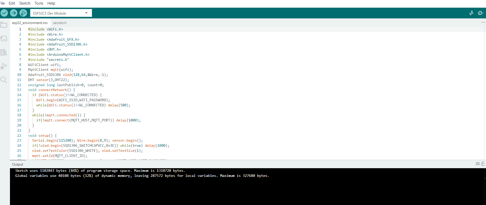
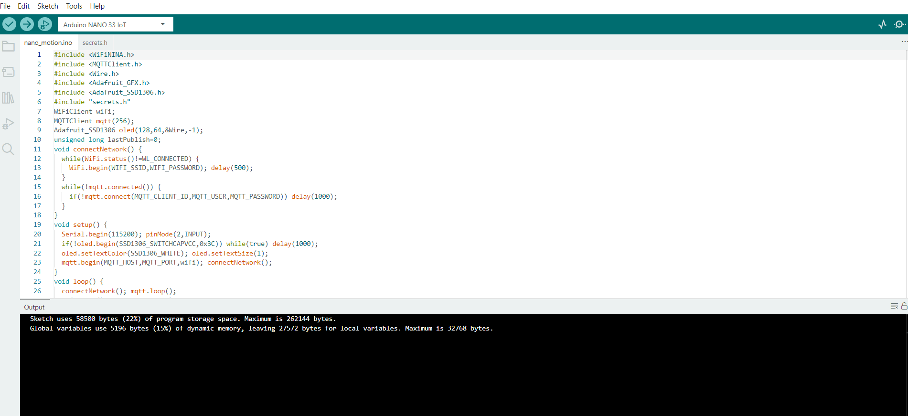

# Firmware Validation and Test Results

## 1. Objective

Validate the compilation of both embedded firmware programs, evaluate compile-time memory utilization and establish a structured hardware testing plan.

## 2. Compilation Environment

- Development environment: Arduino IDE
- Environmental node: ESP32C3 Dev Module
- Motion monitoring node: Arduino Nano 33 IoT
- Programming language: Embedded C/C++
- Validation method: Arduino IDE Verify
- Physical hardware connection: Not required for compilation

## 3. ESP32-C3 Compilation Results

| Parameter | Result |
|---|---:|
| Program storage used | 1,102,843 bytes |
| Maximum program storage | 1,310,720 bytes |
| Flash utilization | 84% |
| Remaining program storage | 207,877 bytes |
| Global variable memory | 40,108 bytes |
| Maximum dynamic memory | 327,680 bytes |
| Dynamic memory utilization | 12% |
| Remaining dynamic memory | 287,572 bytes |
| Compilation status | Passed |

## 4. Arduino Nano 33 IoT Compilation Results

| Parameter | Result |
|---|---:|
| Program storage used | 58,500 bytes |
| Maximum program storage | 262,144 bytes |
| Flash utilization | 22% |
| Remaining program storage | 203,644 bytes |
| Global variable memory | 5,196 bytes |
| Maximum dynamic memory | 32,768 bytes |
| Dynamic memory utilization | 15% |
| Remaining dynamic memory | 27,572 bytes |
| Compilation status | Passed |

## 5. Test Validation Matrix

| Test ID | Test Description | Expected Result | Status |
|---|---|---|---|
| TC-01 | ESP32 firmware compilation | No compilation errors | Passed |
| TC-02 | Nano firmware compilation | No compilation errors | Passed |
| TC-03 | ESP32 flash capacity | Within configured memory limit | Passed |
| TC-04 | Nano flash capacity | Within configured memory limit | Passed |
| TC-05 | ESP32 static RAM capacity | Within memory limit | Passed |
| TC-06 | Nano static RAM capacity | Within memory limit | Passed |
| TC-07 | DHT22 temperature measurement | Valid sensor reading | Not tested |
| TC-08 | DHT22 humidity measurement | Valid sensor reading | Not tested |
| TC-09 | PIR motion detection | Digital state changes with motion | Not tested |
| TC-10 | OLED display | Sensor readings displayed | Not tested |
| TC-11 | Wi-Fi connectivity | Successful connection | Not tested |
| TC-12 | MQTT communication | Valid JSON telemetry received | Not tested |
| TC-13 | Invalid DHT22 reading | Invalid measurement rejected | Not tested |
| TC-14 | Network reconnection | Communication restored | Not tested |

## 6. Engineering Analysis

- Both firmware programs compiled successfully without errors.
- The ESP32-C3 firmware utilizes 84% of its configured program storage capacity.
- The Arduino Nano firmware utilizes 22% of its program storage capacity.
- Both programs fit within their configured static memory limits.
- The ESP32-C3 has less remaining program storage headroom, which should be considered when adding future features.
- Compile-time memory reports do not establish total runtime memory consumption.

## 7. Limitations

The revised firmware was validated through software compilation without connecting physical microcontrollers.

Hardware operation, sensor accuracy, communication reliability, runtime memory consumption and network recovery have not been verified for this revision.

The original MQTT logs provided historical evidence of telemetry activity but did not establish sensor accuracy or packet delivery rates.

## 8. Conclusion

Both firmware programs successfully passed software compilation and compile-time memory capacity checks.

The results establish build compatibility with the selected microcontroller targets. Further physical testing is required to establish end-to-end operational performance.
